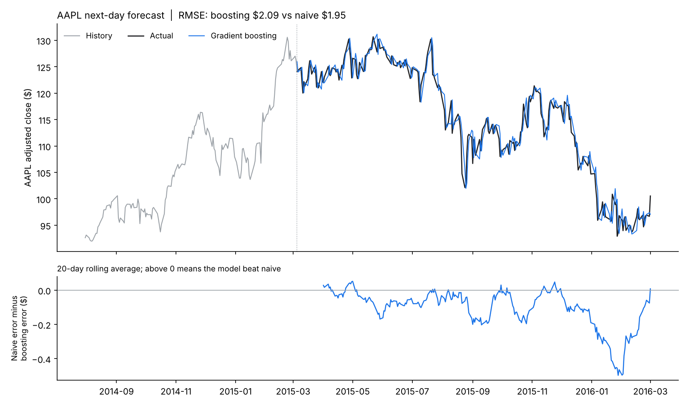

# Stock price forecaster

Predicts tomorrow's closing price from past prices and tests whether machine learning beats the simplest possible guess, "tomorrow's price = today's price".

## Data

Public dataset [plotly/datasets `stockdata.csv`](https://raw.githubusercontent.com/plotly/datasets/master/stockdata.csv): daily adjusted closing prices for **AAPL, MSFT, IBM, SBUX** and the **S&P 500 index (GSPC)**, 2,306 trading days from Jan 2007 to Mar 2016. A copy is saved here as `stockdata.csv`.

The data stops in 2016. The script runs unchanged on any newer CSV of daily prices (see "Run it").

## Results (AAPL, last 250 trading days held out: Mar 2015 to Mar 2016)

| Model | MAE | RMSE | MAPE | Direction right |
|---|---|---|---|---|
| **Naive (tomorrow = today)** | **$1.48** | **$1.95** | **1.31%** | n/a |
| Drift (average daily return) | $1.49 | $1.96 | 1.32% | 45.6% |
| Ridge regression | $1.49 | $1.96 | 1.32% | 42.8% |
| Gradient boosting | $1.57 | $2.09 | 1.40% | 44.0% |

RMSE relative to naive, across all five series (below 1.0 means better than naive):

| | Drift | Ridge | Gradient boosting |
|---|---|---|---|
| MSFT | 0.999 | 1.005 | 1.036 |
| IBM | 1.001 | 1.004 | 1.020 |
| SBUX | 0.999 | 0.995 | 1.008 |
| AAPL | 1.007 | 1.004 | 1.071 |
| S&P 500 | 1.001 | 1.001 | 1.030 |

**Takeaway:** no model meaningfully beats the naive forecast, and gradient boosting is slightly worse everywhere. Its direction calls are right less than half the time. This is the expected result for liquid stocks: daily price changes are close to a random walk, so past prices alone carry almost no usable signal, and a flexible model mostly fits noise. The forecast line in the chart looks accurate only because it hugs yesterday's price.



## How it works

- **Target**: next-day log return, converted back to a price forecast (`price_today × e^predicted_return`).
- **Features** (all known at today's close): last 5 daily returns, 5- and 20-day cumulative return, 20-day volatility, distance from the 50-day moving average, weekday, and the S&P 500's daily and 5-day return.
- **Models**: naive, drift, Ridge regression and scikit-learn `HistGradientBoostingRegressor` (shallow trees, heavy regularization).
- **Evaluation**: trained on 2007 to early 2015, then scored one day ahead on the final 250 trading days, which the models never saw.

## Run it

```bash
pip install pandas numpy scikit-learn matplotlib
python forecast.py                         # AAPL
python forecast.py --ticker MSFT           # any column: MSFT, IBM, SBUX, AAPL, GSPC
python forecast.py --csv prices.csv --ticker Close   # your own data, needs a Date column
```

Outputs: `metrics_<TICKER>.csv`, `holdout_forecast_<TICKER>.csv` (day-by-day predictions), `rmse_vs_naive_all_tickers.csv` and `forecast_<TICKER>.png`.

## Ideas to get real signal

Price history alone is a weak input. Things that sometimes help: forecasting volatility instead of price (volatility is much more predictable), adding outside information (earnings dates, news sentiment, macro data), or predicting over longer horizons.
